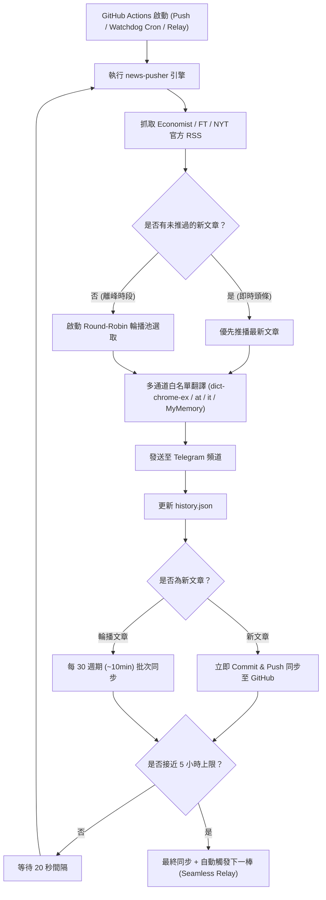

# 📰 News Pusher

> 自動從 The Economist、Financial Times、New York Times、The Wall Street Journal、Bloomberg、Reuters、BBC News、CNBC 抓取最新文章，透過多通道官方擴充繞過技術翻譯成繁體中文後，24/7 持續推送至 Telegram。
>
> Automatically fetches latest articles from global top media (Economist, FT, NYT, WSJ, Bloomberg, Reuters, BBC, CNBC), translates them to Traditional Chinese via multi-channel Chrome extension bypass, and streams them 24/7 to Telegram.

[](https://github.com/innnnnnnnnnn/news-pusher/actions/workflows/push.yml)
[](package.json)
[](LICENSE)

---

## 📺 Dashboard 控制台與管理看板

- **[News Pusher 控制台 (Vercel)](https://news-pusher.vercel.app)**：完整的全球 580+ 媒體資料庫管理、訂閱勾選、即時同步至 GitHub、Telegram 連線設定。
- **[News Pusher 即時看板 (GitHub Pages)](https://innnnnnnnnnn.github.io/news-pusher/)**：輕量靜態即時時事看板與主要媒體訂閱管理。

---

## ✨ 核心特色 / Features

| 功能 | Feature | 說明 |
|------|---------|------|
| 📡 **官方 RSS 抓取** | Official RSS feeds | 輕量高頻抓取，徹底解決 Cloudflare 反爬蟲阻擋，支援 8 大國際頂尖媒體 |
| ⚙️ **即時訂閱熱重載** | Live Subscriptions Hot-Reload | 透過控制台直接同步 `subscriptions.json`，GitHub Actions 引擎於 20 秒內自動依最新勾選生效 |
| ⚡ **多通道免額度翻譯** | Multi-channel Free Translation | Google Chrome 擴充白名單通道（`dict-chrome-ex`、`at`、`it`）+ MyMemory 備援，無需 API Key、無額度限制、繞過機房 429 封鎖 |
| 📬 **Telegram Bot 即時推播** | Telegram Bot push stream | 包含頭條封面、中英雙語對照標題、重點摘要與原文閱讀連結 |
| 🔄 **24/7 不間斷接力架構** | 24/7 Continuous Relay | 單次 Runner 運算 5 小時，結束前自動接力觸發下一輪，達成真正無縫常駐串流 |
| 🐕 **看門狗自癒守護** | Cron Watchdog Self-healing | 每 30 分鐘排程守護；若 GitHub 節點異常斷開，30 分鐘內自動偵測並重生繼電 |
| 🎡 **智慧輪播機制** | Round-Robin Carousel Replay | 當刻無突發即時新聞時，自動輪播 7 天內高價值時事精選，確保資訊流不冷場 |
| 🛡️ **批次同步保護** | Smart Batch Git Sync | 全新文章秒級同步看板，輪播定時批次提交，杜絕 Git 提交洪泛與 Pages 頻繁構建 |

---

## 📰 支援媒體與頻道 / Supported Sources

| 媒體 / Source | 涵蓋頻道 / Channels |
|---------------|-------------------|
| 🗞️ **The Economist（經濟學人）** | Leaders, Finance & Economics, Business, US, China, Asia, International |
| 📰 **Financial Times（金融時報）** | Home Global, Home UK, Global Economy, World News, Companies |
| 📄 **New York Times（紐約時報）** | Home Page, World, Business |
| 📈 **The Wall Street Journal（華爾街日報）** | World News, US Business, Markets Main |
| ⚡ **Bloomberg（彭博社）** | Markets, Technology, Economics |
| 🌐 **Reuters（路透社）** | Top News, Business News, Technology News |
| 🌍 **BBC News（英國廣播公司）** | World, Business, Technology |
| 📊 **CNBC（消費者新聞與商業頻道）** | World News, Finance, Technology |

---

## 🚀 快速開始 / Quick Start

### 1. Fork 這個 Repo / Fork this Repo

```bash
git clone https://github.com/YOUR_USERNAME/news-pusher.git
cd news-pusher
npm install
```

### 2. 設定 GitHub Secrets / Set GitHub Secrets

前往倉庫 `Settings → Secrets and variables → Actions`，僅需設定 2 個密鑰：

| Secret | 必填 | 說明 / Description |
|--------|:---:|-------------------|
| `TELEGRAM_TOKEN` | ✅ | Telegram Bot Token（從 [@BotFather](https://t.me/BotFather) 取得） |
| `CHAT_ID` | ✅ | 你的 Telegram 頻道或群組 Chat ID（用 [@userinfobot](https://t.me/userinfobot) 取得） |

> 💡 **完全免費**：已內建 Google Chrome Client 白名單翻譯通道，**不需要** 申請任何付費翻譯 API Key（如 DeepL 或 OpenAI）。

### 3. 設定訂閱來源（選填）/ Configure Sources (Optional)

前往 `Settings → Variables → Actions`，新增 `SUBSCRIPTIONS`（預設包含全來源）：

```
The Economist, Financial Times, The New York Times
```

### 4. 啟動推播 / Start Pushing

進入 GitHub 儲存庫的 **Actions** 頁籤，點選 **News Pusher Continuous**，點擊 **Run workflow** 即可啟動 24/7 不間斷推播。

---

## 🏗️ 專案結構 / Project Structure

```
news-pusher/
├── scripts/
│   ├── github-push.mjs     # 核心推播腳本（RSS 抓取 → 多通道翻譯 → TG 推播 → 輪播管理）
│   └── daemon.mjs          # 本地/自建 VPS 常駐守護行程模式
├── src/
│   ├── app/                # Next.js Dashboard 前端介面
│   └── lib/                # 資料庫與儲存適配層
├── .github/
│   └── workflows/
│       ├── push.yml        # 24/7 常駐接力 + 看門狗 Workflows
│       └── pr-validate.yml # PR 程式碼品質自動驗證
├── history.json            # 已推送文章資料庫（去重與輪播排程計算）
└── package.json            # 專案相依性與版本宣告
```

---

## ⚙️ 系統架構流程 / How It Works



---

## 📦 版本紀錄 / Changelog

### v2.0.0 — 2026-10-30
- 🚀 **全面重構 24/7 常駐推播引擎**：
  - 導入 5 小時單次生命週期自動繼電接力（Seamless Relay）與 30 分鐘 Cron 看門狗雙重保險，徹底解決無預警中斷停擺問題。
  - 將接力觸發改為 `if: always()`，避免前置步驟警告導致斷鏈。
- ⚡ **多通道免額度翻譯架構**：
  - 實作 Google Chrome 擴充元件官方 Client 白名單通道（`dict-chrome-ex`、`at`、`it`），徹底繞過機房 IP 429 請求限制。
  - 整合 MyMemory 免費 API 作為備援，支援優雅降級回傳原文，移除任何第三方商業翻譯 Key 依賴。
- 🛡️ **批次同步與 Git 洪泛抑制**：
  - 廢除過去每 20 秒頻繁覆蓋拉取與推送遠端 Git 的問題，改採本機持久化輪播記錄。
  - 新文章即時同步、輪播文章定時批次推送，避免觸發 GitHub 濫用機制與萬次 Pages 重複部署。
- 🎡 **輪播池擴大**：時效範圍提升至 168 小時（7 天），大幅提升非高峰時段新聞輪播豐富度。

### v1.0.0 — 2026-10-15
- 🎉 全面改用官方 RSS Feed，移除 Puppeteer（解決 Cloudflare 阻擋問題）。
- ✅ 支援 The Economist、Financial Times、New York Times。
- 📅 新增發布時間過濾，避免推送過時文章。
- 🔧 修正 CDATA 解析格式問題。
- 🚀 GitHub Actions 升級至 Node.js 24。

---

## 🤝 貢獻 / Contributing

歡迎提 [Issue](https://github.com/innnnnnnnnnn/news-pusher/issues) 或 [Pull Request](https://github.com/innnnnnnnnnn/news-pusher/pulls)！

版本控制與開發規範請參閱 [GIT_GUIDE.md](GIT_GUIDE.md)。

---

## 📄 授權 / License

MIT License — 自由使用、修改、分發。/ Free to use, modify, and distribute.
